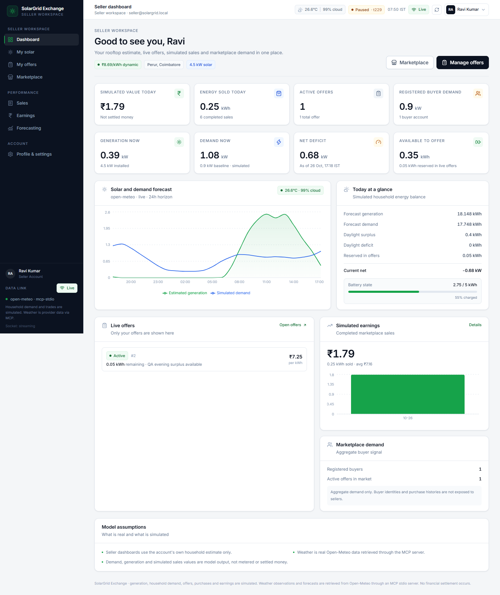

# SolarGrid Exchange

A secure, role-based peer-to-peer solar energy marketplace on top of a working
single-node microgrid control room. Eight seeded households trade simulated
surplus energy using a bounded dynamic price, battery dispatch, and a bipartite
maximum-flow allocator. Real weather and hourly forecasts come from Open-Meteo
through a bundled MCP stdio server.

The original eight-page operator control room remains available to administrators.
Sellers and buyers now sign in to separate, backend-enforced workspaces where they
can publish offers, buy energy, review their own ledger, and inspect their own
forecast and account data. Browsers never receive another account's private
records, and no role can call another role's API surface.

This is a hackathon prototype, not a production market or settlement system.
Energy, prices, allocations, and purchases are simulated and clearly labelled as
such. No money moves.



## What is implemented

### Authentication and roles

- Public registration for **seller** or **buyer** accounts only. Administrator
  registration is rejected by the schema and the API policy check.
- Normalized, case-insensitive, unique email addresses.
- Argon2id password hashing with conservative parameters. Passwords and hashes
  are never returned by an API or written to browser storage.
- Password policy: 10-128 characters, at least one letter and one digit.
- Generic `Invalid email or password.` responses for unknown users and wrong
  passwords, with a dummy hash verification to reduce timing differences.
- Opaque server-side sessions stored as SHA-256 token hashes, delivered in an
  `HttpOnly` cookie with a 12-hour default lifetime.
- Double-submit CSRF protection: a readable `SameSite=Lax` CSRF cookie plus an
  `X-CSRF-Token` header on every state-changing API request. Tokens are rotated
  on login and bound to the server-side session; the client refreshes once if a
  token is missing, stale, or from a different session.
- Same-origin API paths in development. Vite proxies `/api` and `/ws` to the
  backend so the cookies stay first-party whether the UI is opened at
  `localhost` or `127.0.0.1`.
- Sliding-window rate limits for login and registration attempts.
- Session restoration on page reload, session revocation on logout, and
  automatic return to `/login` when a session is missing or expired.
- No authentication token, password, or session identifier in `localStorage`
  or `sessionStorage`.
- Administrator provisioning only through environment bootstrap or the
  `python -m app.admin_cli` command. Public registration can never create an
  administrator.

### Admin control room (unchanged and protected)

- **Overview** - live microgrid KPIs, energy balance, price signal, recent trades,
  simulation controls, and WebSocket freshness.
- **Microgrid** - household map, battery state, cloud scenario overlay,
  step/run controls, and household detail with recent trades.
- **Marketplace** - run the allocator, inspect seller-to-buyer links, and execute
  the resulting simulated trades.
- **Forecasting** - real MCP hourly weather, irradiance, estimated generation,
  temperature derating, and refresh.
- **Optimization** - maximum-flow allocation preview, per-household caps,
  allocation runs, and execution.
- **Transactions** - paginated ledger, filters, totals, and transaction detail
  with an explicit "no payment" notice.
- **Evaluation** - static-vs-dynamic counterfactual replay over identical inputs,
  with both wins and losses reported.
- **Settings** - validated pricing, simulation, and allocation settings persisted
  in SQLite.

### Seller workspace

- `/seller` - dashboard with own solar state, surplus, offers, sales, earnings,
  market demand, and shared pricing.
- `/seller/solar` - own generation, forecast, demand, battery, and surplus.
- `/seller/offers` - create, edit, pause, resume, and cancel offers with explicit
  confirmation for destructive actions. Quantities are checked against current
  seller surplus.
- `/seller/marketplace` - aggregate buyer demand and current marketplace context.
- `/seller/sales` - only the signed-in seller's completed marketplace sales.
- `/seller/earnings` - only the signed-in seller's simulated earnings.
- `/seller/forecasting` - own account forecast using shared MCP weather.
- `/seller/settings` - profile, location, solar capacity, battery, and demand
  settings for the seller's own household.

### Buyer workspace

- `/buyer` - dashboard with own demand/deficit, preferred offers, spending, and
  current price.
- `/buyer/marketplace` - active offers with search, max-price and minimum-quantity
  filters, sorting, and a confirmation dialog before purchase.
- `/buyer/purchases` - only the signed-in buyer's purchases and linked simulated
  transactions.
- `/buyer/usage` - own demand, deficit, generation, and purchase totals.
- `/buyer/prices` - current price, history, and 24-hour price forecast.
- `/buyer/settings` - profile, location, category, and demand settings for the
  buyer's own household.

### Shared intelligence

- Shared MCP weather, forecast, dynamic pricing, and non-private microgrid status
  are available to every authenticated role.
- One shared WebSocket invalidation/event stream remains in place. REST polling
  still works when the socket is unavailable.
- Account-owned households are persisted in the same `households` table with
  `owner_user_id` and are excluded from the eight seeded simulation households.
- A marketplace purchase creates a `PurchaseOrder`, plus a linked marketplace
  `AllocationRun` and `Transaction`, so the ledger is consistent and auditable.
- An administrator **Reset** removes simulation-source runs and transactions;
  marketplace purchase records and their ledger entries survive.

### Purchase integrity

- The buyer UI sends only `offer_id` and `quantity_kwh`; the server ignores any
  client-supplied price.
- The server re-reads the offer inside the purchase transaction, rejects inactive
  or exhausted offers, and conditionally decrements `remaining_kwh` so
  concurrent requests cannot oversell the same energy.
- The authoritative offer price and server-computed total are used for the
  purchase and linked transaction.
- Requests that exceed the remaining quantity return `409` with a clear message.

## Routes

| Area | Routes |
| --- | --- |
| Public | `/login`, `/register` |
| Admin | `/`, `/microgrid`, `/marketplace`, `/forecasting`, `/optimization`, `/transactions`, `/evaluation`, `/settings` |
| Seller | `/seller`, `/seller/solar`, `/seller/offers`, `/seller/marketplace`, `/seller/sales`, `/seller/earnings`, `/seller/forecasting`, `/seller/settings` |
| Buyer | `/buyer`, `/buyer/marketplace`, `/buyer/purchases`, `/buyer/usage`, `/buyer/prices`, `/buyer/settings` |

The route guards are cosmetic and navigational only; the backend independently
enforces every boundary. A seller or buyer who opens the wrong role route sees a
restricted-workspace screen, and direct API calls to the wrong role return `403`.
Anonymous protected requests return `401` at the API and redirect to `/login` in
the app with a `next` path.

## Architecture

```text
Open-Meteo
   |
   v
backend/mcp_weather_server.py  (real MCP server over stdio)
   |
   v
FastAPI + role-aware services + SQLite (WAL)
   |-- Argon2id identity + opaque sessions + CSRF + rate limits
   |-- solar estimate -> battery dispatch -> dynamic pricing
   |-- Edmonds-Karp max-flow allocation -> simulated transactions
   |-- direct offer purchases -> atomic purchase/transaction records
   |-- evaluation replay (static vs dynamic)
   |
   |-- REST /api/v1/*  -> public, authenticated, seller, buyer, admin
   `-- WebSocket /ws/simulation -> shared invalidation/event stream
          |
          v
React workspace shell (Vite, strict TypeScript)
   |-- public auth screens
   |-- admin control room
   |-- seller workspace
   `-- buyer workspace
```

The backend and frontend are separate processes. In development the frontend
uses relative `/api/v1` and `/ws/simulation` paths, and Vite proxies them to
`http://127.0.0.1:8010`. That keeps the `HttpOnly` session cookie and readable
CSRF cookie on the same origin for both `localhost` and `127.0.0.1`; a direct
cross-host API URL would make the `SameSite=Lax` CSRF cookie cross-site and the
browser would not send it. Port `8000` was occupied on the delivery host
(`WinError 10048`), so all local examples use `8010`.

### Stack

| Layer | Technology |
| --- | --- |
| Frontend | React 19, TypeScript 5.9 (strict), Vite 8, Tailwind CSS 4, Recharts 3, Lucide, React Router 7, TanStack Query 5 |
| Backend | FastAPI, Pydantic 2, SQLAlchemy 2, SQLite (WAL), Uvicorn, Argon2id via `argon2-cffi` |
| Weather | Open-Meteo through the `mcp` Python client and a bundled MCP stdio server |
| Tests | pytest / pytest-asyncio, Vitest, Testing Library |

## Data provenance

| Signal | Source | Classification |
| --- | --- | --- |
| Current temperature, humidity, cloud cover, wind, irradiance | Open-Meteo current conditions through MCP | Reported external data |
| Hourly temperature and irradiance forecast | Open-Meteo hourly forecast through MCP | Predicted external data |
| Solar generation | Provider irradiance x installed capacity x performance/orientation/temperature factors | Estimated, not metered |
| Household demand | Seeded deterministic profile with bounded noise | Simulated |
| Battery SOC and charge/discharge | Ideal capacity/C-rate model, no degradation | Simulated |
| Dynamic price | Documented bounded supply/demand rule | Simulated market mechanism |
| Offers and purchases | Account input plus server-side availability checks | Simulated marketplace records |
| Allocations, trades, and transaction values | Max-flow result or direct offer purchase, multiplied by price | Simulated; no money moves |
| Evaluation comparison | Replay computed from the rows above | Counterfactual, not field evidence |

The MCP server's irradiance field is the provider's shortwave-radiation value,
not an on-site sensor. The app never presents it as a meter reading.

## Quick start (Windows PowerShell)

Requirements: Python 3.13, Node.js 24, npm 11, and outbound HTTPS access to
Open-Meteo. No weather API key is required.

### 1. Backend

```powershell
cd D:\frontend\backend
py -3.13 -m venv .venv              # first run only
.\.venv\Scripts\python.exe -m pip install -r requirements.txt
$env:PYTHONPATH='D:\frontend\backend'
.\.venv\Scripts\python.exe -m uvicorn app.main:app --host 127.0.0.1 --port 8010
```

The first startup creates `backend\data\microgrid.db`, seeds eight simulated
households, applies the additive account/offer/purchase migration, and obtains
weather through MCP. OpenAPI is at `http://127.0.0.1:8010/docs`.

### 2. Administrator

Public registration cannot create an administrator. Choose one of these paths:

**Environment bootstrap on startup** (only when both values are present):

```powershell
$env:BOOTSTRAP_ADMIN_EMAIL='operator@example.com'
$env:BOOTSTRAP_ADMIN_NAME='SolarGrid Operator'
$env:BOOTSTRAP_ADMIN_PASSWORD='use-a-long-unique-password'
.\.venv\Scripts\python.exe -m uvicorn app.main:app --host 127.0.0.1 --port 8010
```

**Explicit CLI provisioning** (recommended for an existing database):

```powershell
cd D:\frontend\backend
$env:PYTHONPATH='D:\frontend\backend'
$env:BOOTSTRAP_ADMIN_PASSWORD='use-a-long-unique-password'
.\.venv\Scripts\python.exe -m app.admin_cli --email operator@example.com --name "SolarGrid Operator"
```

If the account already exists, add `--reset-password` to rotate its password.
The CLI never promotes a seller or buyer account to administrator.

### 3. Frontend

In a second terminal:

```powershell
cd D:\frontend
Copy-Item .env.example .env          # first run only; keep the relative API/WS paths
npm install
npm run dev
```

Open `http://127.0.0.1:5173` or `http://localhost:5173`. Register a seller or
buyer, or sign in with the administrator created above. The Vite proxy forwards
API and WebSocket traffic to the backend on port `8010`.

### 4. Clean data

The local database is intentionally outside version control. To start from a
clean seed, stop the backend and remove the database files:

```powershell
Remove-Item D:\frontend\backend\data\microgrid.db*
```

This removes accounts and marketplace history too. The administrator must be
provisioned again. The admin UI **Reset** action is narrower: it clears
simulation history and evaluation runs while preserving marketplace purchases
and their ledger entries.

## Configuration

The backend reads the repository `.env` and, if present, `backend/.env`.
Environment variables use the names below. See [`.env.example`](.env.example).

### Frontend and infrastructure

| Variable | Default | Purpose |
| --- | --- | --- |
| `VITE_API_BASE_URL` | `/api/v1` in the example | Frontend REST base. Relative means same-origin. |
| `VITE_WS_URL` | `/ws/simulation` | Frontend WebSocket path; relative paths are resolved against the page origin. |
| `DATABASE_URL` | `sqlite:///.../backend/data/microgrid.db` | SQLAlchemy database URL |
| `CORS_ORIGINS` | `http://localhost:5173,http://127.0.0.1:5173` | Explicit credentialed browser origins for direct cross-origin API use |
| `LATITUDE`, `LONGITUDE`, `LOCATION_NAME`, `TIMEZONE` | Perur, Coimbatore / `Asia/Kolkata` | Weather location |
| `WEATHER_MCP_ENABLED` | `true` | Enables the real MCP weather path |
| `WEATHER_MCP_SCRIPT` | `backend/mcp_weather_server.py` | MCP server entry point |
| `WEATHER_MCP_COMMAND` | Python executable | Optional interpreter override |
| `WEATHER_MCP_TIMEOUT_SECONDS` | `45` | MCP call timeout |
| `WEATHER_CACHE_TTL_SECONDS` | `600` | Reuse window for current/forecast weather |
| `WEATHER_STALE_AFTER_SECONDS` | `1800` | "Live" -> "stale" boundary |
| `WEATHER_EXPIRE_AFTER_SECONDS` | `21600` | "Stale" -> "expired" boundary |
| `WEATHER_FORECAST_HOURS` | `24` | Default forecast horizon |
| `SIMULATION_TICK_SECONDS` | `5` | Wall-clock delay between automatic ticks |
| `SIMULATION_INTERVAL_SECONDS` | `300` | Simulated market interval length |
| `SIMULATION_SEED` | `20261026` | Deterministic demand seed |
| `AUTO_EXECUTE_TRADES` | `true` | Persist allocated trades automatically |
| `BASE_PRICE_INR_KWH` | `6.0` | Static tariff / dynamic price anchor |
| `MIN_PRICE_INR_KWH`, `MAX_PRICE_INR_KWH` | `3.0`, `12.0` | Dynamic price bounds |
| `PRICE_SENSITIVITY` | `3.0` | Imbalance-to-price slope |
| `PRICE_SMOOTHING` | `0.65` | Previous-price weight |
| `MAX_TRADE_KW_PER_HOUSEHOLD` | `4.0` | Per-household trade cap |
| `BATTERY_MAX_RATE_RATIO` | `0.5` | Battery C-rate as a fraction of capacity |

### Authentication and sessions

| Variable | Default | Purpose |
| --- | --- | --- |
| `SESSION_COOKIE_NAME` | `sg_session` | HttpOnly opaque session cookie |
| `CSRF_COOKIE_NAME` | `sg_csrf` | Readable double-submit CSRF cookie |
| `SESSION_TTL_HOURS` | `12` | Server-side session lifetime |
| `SESSION_COOKIE_SECURE` | `false` | Set to `true` behind HTTPS in production |
| `SESSION_COOKIE_SAMESITE` | `lax` | Session and CSRF cookie SameSite policy |
| `LOGIN_RATE_LIMIT_ATTEMPTS` | `8` | Login attempts per window/key |
| `LOGIN_RATE_LIMIT_WINDOW_SECONDS` | `600` | Login rate-limit window |
| `REGISTRATION_RATE_LIMIT_ATTEMPTS` | `10` | Registrations per window/IP |
| `REGISTRATION_RATE_LIMIT_WINDOW_SECONDS` | `3600` | Registration window |
| `BOOTSTRAP_ADMIN_EMAIL` | unset | Optional first-start administrator email |
| `BOOTSTRAP_ADMIN_PASSWORD` | unset | Optional first-start administrator password |
| `BOOTSTRAP_ADMIN_NAME` | `SolarGrid Operator` | Optional administrator display name |

Set `SESSION_COOKIE_SECURE=true` whenever the app is served over HTTPS. The
local example leaves it `false` because the development frontend and API run on
plain HTTP.

Keep the frontend and API on the same origin in production, typically by
proxying `/api` and `/ws` from the static host. If the API must live on a
different site, serve both over HTTPS, set `SESSION_COOKIE_SAMESITE=none`, set
`SESSION_COOKIE_SECURE=true`, and list the exact frontend origin in
`CORS_ORIGINS`. Wildcard origins are not enabled for credentialed requests.

Settings changed through the admin UI are stored in SQLite and take precedence
for the running installation.

## Security boundary

The backend, not the frontend, is the authorization boundary:

| API surface | Required identity |
| --- | --- |
| `/health`, `/auth/csrf`, `/auth/session`, `/auth/register`, `/auth/login`, `/auth/logout`, `/ws/simulation` | Public (auth screens and the shared read-only event socket) |
| `/shared/status`, `/weather/*`, `/forecast`, `/pricing/current`, `/pricing/history`, `/market/offers*` | Any authenticated role |
| `/seller/*` | Seller only; offer detail/edit/status actions additionally require ownership |
| `/buyer/*`, `POST /buyer/purchases` | Buyer only |
| `/households/*`, `/simulation/*`, `/optimization/*`, `/transactions/*`, `/evaluation/*`, `/settings/*`, `/metrics/summary` | Administrator only |

Additional guarantees:

- State-changing API requests require a matching CSRF cookie and header. Once a
  session exists, the token digest must also match that session; tokens minted
  for another session are rejected with `403`.
- Sellers cannot buy or read buyer-private purchases.
- Buyers cannot create, edit, pause, resume, or cancel offers.
- Administrators cannot use seller or buyer workspaces; role routes return `403`.
- Offer detail and mutation checks return `404` for another seller's offer rather
  than revealing its existence.
- Buyer purchase lists are filtered by `buyer_user_id`; seller sales are filtered
  by `seller_user_id`.
- Offer and purchase writes are wrapped in database transactions. Quantity is
  revalidated and decremented atomically to prevent overselling under concurrent
  requests.
- The shared status payload contains no account-private purchase or offer data.
- Account households are excluded from the seeded admin simulation.

### Operational hardening still required for production

- Serve over HTTPS and set `SESSION_COOKIE_SECURE=true`.
- Replace the in-process rate limiter if running multiple API workers.
- Add password reset, email verification, MFA, session/device management, and
  audit logging appropriate to the deployment.
- Rotate administrator credentials and never commit them to `.env`.
- Use a production database, external session store, and managed secrets.
- Add a formal authorization test matrix that covers every future route.

## API summary

All application routes are under `/api/v1` unless noted.

### Public and shared

| Method | Path | Purpose |
| --- | --- | --- |
| `GET` | `/health` | Process, database, and weather status |
| `GET` | `/auth/csrf` | Issue/refresh the CSRF cookie and token |
| `GET` | `/auth/session` | Restore the current session or return `user: null` |
| `POST` | `/auth/register` | Create a seller or buyer account |
| `POST` | `/auth/login` | Create an opaque session |
| `POST` | `/auth/logout` | Revoke the session and clear cookies |
| `GET` | `/shared/status` | Authenticated shared microgrid/weather/pricing status |
| `GET` | `/weather/current`, `/weather/status` | Authenticated current weather and cache state |
| `GET` | `/weather/forecast?hours=24` | Authenticated MCP forecast |
| `GET` | `/forecast?horizon_hours=24` | Authenticated generation/demand forecast |
| `GET` | `/pricing/current`, `/pricing/history` | Authenticated price signal |
| `GET` | `/market/offers`, `/market/offers/{id}` | Authenticated active marketplace offers |
| `WS` | `/ws/simulation` | Shared simulation status/event stream |

### Seller

| Method | Path | Purpose |
| --- | --- | --- |
| `GET` | `/seller/dashboard` | Own dashboard aggregate |
| `GET`, `PATCH` | `/seller/profile` | Own seller profile |
| `GET` | `/seller/solar`, `/seller/forecast` | Own solar/forecast snapshot |
| `GET` | `/seller/offers`, `/seller/offers/{id}` | Own offers and detail |
| `GET` | `/seller/offers/availability` | Current surplus available to offer |
| `POST` | `/seller/offers` | Create an offer |
| `PATCH` | `/seller/offers/{id}` | Edit own offer |
| `POST` | `/seller/offers/{id}/pause`, `/resume`, `/cancel` | Change own offer status |
| `GET` | `/seller/sales`, `/seller/earnings` | Own sales and simulated earnings |
| `GET` | `/seller/market-demand` | Aggregate marketplace demand |

### Buyer

| Method | Path | Purpose |
| --- | --- | --- |
| `GET` | `/buyer/dashboard` | Own dashboard aggregate |
| `GET`, `PATCH` | `/buyer/profile` | Own buyer profile |
| `GET` | `/buyer/purchases` | Own purchase ledger |
| `POST` | `/buyer/purchases` | Purchase from an active offer |
| `GET` | `/buyer/spending` | Own simulated spending totals |
| `GET` | `/buyer/usage` | Own usage/demand snapshot |
| `GET` | `/buyer/prices` | Current price, history, and price forecast |

### Administrator

| Method | Path | Purpose |
| --- | --- | --- |
| `GET` | `/households`, `/households/{id}` | Seeded household snapshots and detail |
| `GET` | `/simulation/state`, `/dashboard`, `/history` | Simulation snapshot/history |
| `POST` | `/simulation/start`, `/pause`, `/step`, `/reset` | Simulation controls |
| `POST` | `/simulation/scenario/cloud` | Synthetic cloud overlay |
| `POST` | `/optimization/run` | Run max-flow allocation |
| `POST` | `/optimization/transactions/execute` | Persist the latest allocation |
| `GET` | `/transactions`, `/transactions/{id}` | Paginated history and detail |
| `POST` | `/transactions/execute` | Execute the latest allocation |
| `POST` | `/evaluation/run` | Replay static vs dynamic pricing |
| `GET` | `/evaluation/latest`, `/evaluation/summary` | Saved evaluation |
| `GET`, `PATCH` | `/settings` | Validated persistent settings |
| `GET` | `/metrics/summary` | Combined operator metrics |

The WebSocket is an acceleration layer only. It carries shared simulation status
and transaction/evaluation invalidation events, not account-private records. The
frontend can fall back to REST polling if it cannot connect.

## Verification

### Backend tests

```powershell
cd D:\frontend\backend
$env:PYTHONPATH='D:\frontend\backend'
.\.venv\Scripts\python.exe -m pytest -q
```

Result: **64 passed**, 1 benign Starlette/httpx deprecation warning.

Coverage includes the original simulation, solar, demand, weather, battery,
pricing, allocation, transaction, and evaluation behavior, plus:

- registration normalization, unique email, password policy, and no admin
  public registration;
- Argon2id verification, generic login failure, session restore, logout, and
  expired-session handling;
- CSRF valid, missing-header, missing-cookie, invalid-token, and
  unrelated-session rejection, plus token rotation recovery;
- session and CSRF cookie attributes (`HttpOnly`, `SameSite=Lax`, `Path`, max
  age) and explicit CORS allow/deny behavior;
- rate limiting and role-protected API access;
- seller/buyer cross-account access and role-boundary checks;
- offer create/edit/pause/resume/cancel and ownership enforcement;
- purchase price authority, remaining-quantity checks, transaction linkage, and
  a file-backed concurrent oversell test.

### Frontend tests, typecheck, lint, and build

```powershell
cd D:\frontend
npm run typecheck
npm run lint
npm run test
npm run build
```

Result: strict typecheck passed, ESLint passed, **39/39** Vitest tests passed,
and the production build completed. The built app is in `dist/`.

Coverage includes:

- registration validation, password confirmation, role selection, and API
  failure messaging;
- login, logout, session restoration, expiry handling, and `next` redirects;
- guard loading gates, anonymous redirects, wrong-role blocking, and guest-only
  auth screens;
- role-aware sidebar/navigation and mobile navigation;
- seller offer creation/status/confirmation behavior;
- buyer marketplace empty state, filters/sort, API failure retry, purchase
  confirmation, and ensuring the client sends only offer ID and quantity;
- API error normalization and session-expiry events;
- same-origin API base and WebSocket URL resolution, plus a single CSRF refresh
  and retry when the server rejects a stale token.

The production build emits the existing Vite chunk-size warning: the main JS
bundle is about 1.01 MB (277 KB gzip), above the 900 KB warning threshold. The
build still succeeds; route-level code splitting is the next performance step.

### Browser QA

Chromium at 1440x960 and 390x844 was driven against the running app:

- anonymous protected route redirected to `/login` with the `next` path;
- login form, seller and buyer sign-in, restoration gate with no private-content
  flash, and session-cookie inspection;
- session cookie was `HttpOnly`, CSRF cookie was readable, and neither
  `localStorage` nor `sessionStorage` contained auth material;
- seller dashboard, solar, offers, marketplace, sales, earnings, forecasting, and
  settings routes;
- seller offer create -> pause -> resume -> cancel through the UI;
- buyer dashboard, marketplace, purchases, usage, prices, and settings routes;
- buyer purchase confirmation and updated purchase ledger;
- wrong-role restricted-workspace screen for buyer and administrator;
- missing/expired session redirect;
- administrator overview, microgrid, optimization, and transactions routes;
- 390 px layout with zero horizontal overflow and working mobile navigation;
- zero console errors, page errors, or HTTP 5xx responses.

**40 checks passed, 0 failed.** The full result record is in
[`docs/browser-verification.json`](docs/browser-verification.json).

A focused Chromium pass then covered the reported CSRF failure at both
`http://localhost:5173` and `http://127.0.0.1:5173`:

- invalid credentials returned the generic `401` credential error, not a CSRF
  `403`;
- valid seller login reached `/seller` at both hostnames;
- registration created a new seller and reached `/seller` at both hostnames;
- every API and WebSocket request stayed same-origin through the Vite proxy;
- session cookie was `HttpOnly`; CSRF cookie was readable; neither appeared in
  web storage;
- seller access to buyer and operator routes remained blocked;
- operator login could open `/settings`;
- a forced stale CSRF token produced the expected `403`, a `/auth/csrf`
  refresh, and a successful retried logout `204`;
- zero CSRF `403`, API `5xx`, page errors, or unexpected console errors on the
  normal flows.

**35 checks passed, 0 failed**, and the separate forced-stale-token retry check
also passed (`403` -> CSRF refresh -> retried logout `204`).

Selected screenshots:

| Screen | Image |
| --- | --- |
| Sign in | [login.png](docs/screenshots/login.png) |
| Seller dashboard | [seller-dashboard.png](docs/screenshots/seller-dashboard.png) |
| Seller offers | [seller-offers.png](docs/screenshots/seller-offers.png) |
| Buyer dashboard | [buyer-dashboard.png](docs/screenshots/buyer-dashboard.png) |
| Buyer marketplace | [buyer-marketplace.png](docs/screenshots/buyer-marketplace.png) |
| Admin overview | [admin-overview.png](docs/screenshots/admin-overview.png) |
| Mobile buyer marketplace | [mobile-buyer-marketplace.png](docs/screenshots/mobile-buyer-marketplace.png) |
| Mobile navigation | [mobile-navigation.png](docs/screenshots/mobile-navigation.png) |

Older operator screenshots remain in `docs/screenshots/` for reference.

### MCP proof

```powershell
cd D:\frontend\backend
$env:PYTHONPATH='D:\frontend\backend'
cmd /c ".venv\Scripts\python.exe _mcp_probe.py > D:\frontend\docs\mcp-verification.txt 2>&1"
Get-Content D:\frontend\docs\mcp-verification.txt
```

Verified on 2026-10-26: server `open-meteo-weather 1.30.0`, tools
`get_current_weather` and `get_weather_forecast`, and a provider response with
`status: ok`, `temperature_c: 28.6`, `cloud_cover_pct: 91`, and
`irradiance_w_m2: 480` at the captured observation time. Live values change; the
raw capture is in [`docs/mcp-verification.txt`](docs/mcp-verification.txt).

## Measured evaluation results

The evaluation starts at the first forecast hour with at least 500 W/m2 of
provider irradiance, so the comparison still contains solar production when the
page is opened after sunset. Both strategies use the same window, seed, battery
model, and allocator. The start time is shown in the result.

**Dynamic wins** - 24 intervals, 25% cloud overlay, replay start
`2026-10-27T03:30:00Z` (09:00 IST):

| Metric | Static | Dynamic |
| --- | ---: | ---: |
| Energy traded | 1.3498 kWh | 1.4263 kWh |
| Unmet demand | 1.6954 kWh | 1.6189 kWh |
| Renewable utilization | 92.22% | 97.44% |
| Avg. transaction price | INR 6.0000/kWh | INR 7.0092/kWh |

Dynamic reduced unmet demand by **0.0765 kWh (4.51%)** and raised utilization by
**5.22 percentage points**.

**Dynamic loses** - 48 intervals, 0% cloud overlay, same daylight start:

| Metric | Static | Dynamic |
| --- | ---: | ---: |
| Energy traded | 4.5635 kWh | 3.8558 kWh |
| Unmet demand | 0.5246 kWh | 1.2320 kWh |
| Renewable utilization | 47.10% | 39.80% |
| Avg. transaction price | INR 6.0000/kWh | INR 5.0957/kWh |

Dynamic increased unmet demand by **0.7074 kWh (134.85% relative to static
unmet demand)** and reduced utilization by **7.3 percentage points**. The UI
reports this without adjustment or hiding.

These are replay results from the dates shown, not a claim of field superiority.

## Demo flow

1. Start the backend and frontend. Provision an administrator if this is a new
   database.
2. Open `http://127.0.0.1:5173` or `http://localhost:5173`. Register a seller, then sign in.
3. Create an offer from **My offers**. Point out the server-derived availability,
   price checks, and lifecycle actions.
4. Sign out. Register a buyer, sign in, and purchase part of the offer from
   **Marketplace**. The confirmation dialog shows the quantity and simulated
   total; the purchase ledger updates.
5. Open a seller route as the buyer to show the restricted-workspace guard.
6. Sign out and sign in as the administrator. Show the original Overview,
   Microgrid, Marketplace, Optimization, Transactions, Evaluation, and Settings
   pages.
7. Press **Step once** on Overview, run a cloud scenario, inspect a household
   drawer, and open the real MCP weather/forecast views.
8. Run the allocation and evaluation flows. Show both a dynamic win and a dynamic
   loss without hiding either.
9. Resize to a phone width to show the single-column seller/buyer/admin layouts
   and the mobile navigation drawer.

## Assumptions and limitations

- **Simulation, not settlement.** No payment, wallet, blockchain, tax, meter, or
  financial settlement exists. Purchases move simulated energy and simulated
  value only.
- **Single location, one weather source.** All households share provider weather
  for Perur, Coimbatore. There is no per-roof sensor, shading survey, or
  irradiance nowcast.
- **Solar is estimated.** The model uses provider irradiance, capacity, a fixed
  performance factor, orientation, and a temperature derate. It is not metered
  generation and is not a bankable yield model.
- **Demand is synthetic.** It is deterministic with seeded noise, not smart-meter
  data.
- **Batteries are ideal.** C-rate and SOC bounds are enforced, but round-trip
  efficiency, degradation, thermal limits, and inverter behavior are not modelled.
- **Network map is logical.** Connections mean market eligibility, not electrical
  topology. There are no voltage, frequency, protection, or congestion
  constraints.
- **Allocation is max-flow, not optimal power flow.** It maximizes served demand
  subject to offers, requests, and per-household caps.
- **Evaluation is counterfactual.** It replays a representative daylight forecast
  window and synthetic cloud overlay; it is not evidence of real-world savings.
- **Persistence and scale.** SQLite, the in-process rate limiter, and the
  in-process WebSocket hub are suitable for one demo node. There is no horizontal
  scale, external session store, or production observability.
- **Session transport.** Local development uses HTTP with
  `SESSION_COOKIE_SECURE=false`. Production must use HTTPS and set it to `true`.
- **Account lifecycle.** There is no password reset, email verification, MFA,
  account deletion, or self-service administrator promotion.
- **Email validation.** The environment could not install `email-validator`;
  the backend uses a documented custom regex with a length bound.
- **Browser QA.** Chromium only; Firefox/Safari and a formal accessibility audit
  were not part of this pass.
- **Bundle size.** The production build exceeds Vite's 900 KB chunk warning
  threshold. Code splitting is recommended before a performance-sensitive launch.
- **Host-specific port.** Port `8000` was unavailable (`WinError 10048`), so all
  local examples use `8010`.
- **Verification data.** The current local SQLite database contains seeded
  households, QA accounts, offers, purchases, and cancelled offers. A fresh
  checkout is unaffected; remove `backend\data\microgrid.db*` for a clean start.

## Project layout

```text
D:\frontend
|-- src/
|   |-- api/                 typed REST clients for auth, seller, buyer, market, shared
|   |-- components/          layout, charts, tables, dialogs, account, auth guards
|   |-- context/             AuthProvider and shared WebSocket provider
|   |-- hooks/               TanStack Query hooks and account actions
|   |-- pages/               admin, auth, seller, and buyer route pages
|   `-- types/               API and account types
|-- backend/
|   |-- app/
|   |   |-- api/routes/      public, shared, seller, buyer, admin routes
|   |   |-- services/        security, marketplace, accounts, weather, simulation,
|   |   |                    pricing, allocation, evaluation
|   |   |-- models.py        users, profiles, sessions, offers, purchases, ledger
|   |   |-- schemas.py       Pydantic contracts
|   |   |-- admin_cli.py     explicit administrator provisioning
|   |   `-- main.py          app, CORS, CSRF, lifespan, WebSocket
|   |-- tests/               64 pytest tests
|   |-- mcp_weather_server.py real MCP stdio weather server
|   `-- requirements.txt
|-- docs/                    screenshots, MCP proof, browser QA record
|-- README.md
`-- IMPLEMENTATION_STATUS.md
```

## Troubleshooting

- **`[WinError 10048]` / address already in use** - another process owns the
  port. Use `8010` and update both `VITE_*` values, or stop the old process.
- **"Weather unavailable"** - check outbound HTTPS to Open-Meteo, the MCP script
  path, and `WEATHER_MCP_ENABLED=true`. Run `_mcp_probe.py` to isolate MCP from
  the rest of the backend.
- **401 on every protected page** - check that cookies are enabled, the frontend
  origin matches `CORS_ORIGINS` if you use an absolute API URL, and the API is
  reachable on `8010`.
- **403 CSRF validation failed** - open the UI through the Vite proxy with
  `VITE_API_BASE_URL=/api/v1`; do not mix `localhost:5173` with an API on
  `127.0.0.1:8010` because the `SameSite=Lax` cookie becomes cross-site. The
  client fetches `/auth/csrf`, sends the readable `sg_csrf` value in
  `X-CSRF-Token`, and retries once after rotating a stale token.
- **Cannot create an administrator** - public registration is intentionally
  seller/buyer only. Use `python -m app.admin_cli` or the bootstrap environment
  variables.
- **Frontend shows empty states** - confirm the backend is on `8010` and the
  browser console shows requests to `/api/v1`, not port `8000`.
- **Evaluation is unavailable** - evaluation intentionally fails if weather is
  not usable; it does not substitute invented inputs.
- **Stale local demo data** - use the admin **Reset** for simulation history, or
  delete `backend\data\microgrid.db*` and restart for a completely clean seed.
