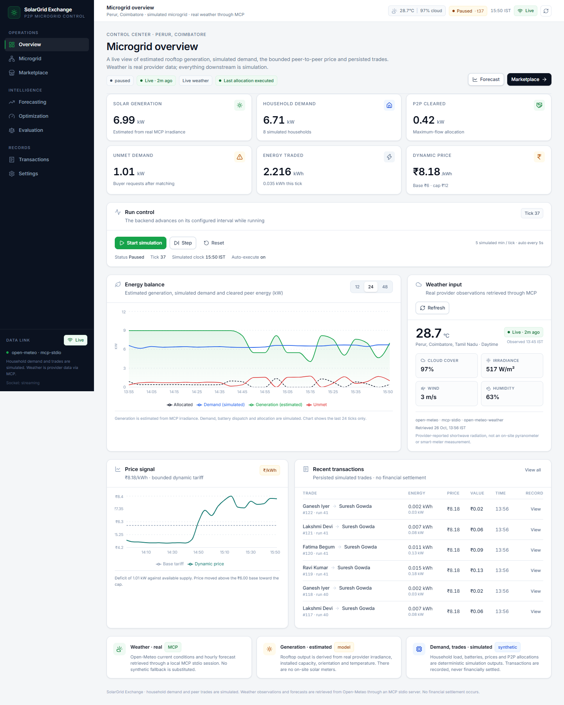

# SolarGrid Exchange

A working, single-node peer-to-peer solar microgrid control room. Eight simulated
households trade surplus solar energy using a bounded dynamic price, battery
dispatch, and a bipartite maximum-flow allocator. Current weather and hourly
forecasts come from the real Open-Meteo provider through a genuine MCP stdio
server bundled in the repository.

This is a hackathon prototype, not a production market or a settlement system.
Every value is labelled by provenance: provider-reported, estimated, or
simulated.



## What is implemented

- **Overview** — live microgrid KPIs, energy balance, price signal, recent trades,
  simulation controls, and WebSocket freshness.
- **Microgrid** — household map, per-household status, battery SOC, cloud
  scenario overlay, step/run controls, and a detail drawer with recent trades.
- **Marketplace** — run the allocator against the current interval, inspect
  seller-to-buyer links, and execute the resulting trades.
- **Forecasting** — real MCP hourly weather forecast, provider irradiance,
  estimated solar generation, temperature derating, and a refresh action.
- **Optimization** — maximum-flow allocation preview, per-household trade caps,
  allocation runs, and execution.
- **Transactions** — server-side pagination, household filters, total count, and
  transaction detail with an explicit “no payment” notice.
- **Evaluation** — static-vs-dynamic counterfactual replay over identical weather,
  demand, battery state, and allocation constraints. It reports losses as well
  as wins.
- **Settings** — validated pricing, simulation, and allocation controls that
  persist in SQLite.
- **Realtime** — one shared WebSocket for invalidation and event display. REST
  polling remains functional if the socket fails.

## Architecture

```text
Open-Meteo
   │ HTTPS
   ▼
backend/mcp_weather_server.py  (MCP server over stdio)
   │ MCP tool calls: get_current_weather, get_weather_forecast
   ▼
FastAPI + weather service + SQLite
   │
   ├─ solar estimate ─ battery dispatch ─ dynamic pricing
   ├─ Edmonds–Karp max-flow allocation ─ transaction persistence
   ├─ evaluation replay (static vs dynamic)
   │
   ├─ REST /api/v1/*
   └─ WebSocket /ws/simulation
          │
          ▼
React control room (Vite, strict TypeScript)
```

The backend and frontend are separate processes. The checked-in local `.env`
points the frontend at `http://127.0.0.1:8010`. Port `8000` was occupied on the
delivery host, so all local examples consistently use `8010`.

### Stack

| Layer | Technology |
| --- | --- |
| Frontend | React 19, TypeScript 5.9 (strict), Vite 8, Tailwind CSS 4, Recharts 3, Lucide, React Router 7, TanStack Query 5 |
| Backend | FastAPI, Pydantic 2, SQLAlchemy 2, SQLite (WAL), Uvicorn |
| Weather | Open-Meteo through the `mcp` Python client and a local MCP stdio server |
| Tests | pytest / pytest-asyncio, Vitest, Testing Library |

## Data provenance

| Signal | Source | Classification |
| --- | --- | --- |
| Current temperature, humidity, cloud cover, wind, irradiance | Open-Meteo current-conditions API through MCP | **Reported external data** |
| Hourly temperature and irradiance forecast | Open-Meteo hourly forecast through MCP | **Predicted external data** |
| Solar generation | Irradiance × installed capacity × performance/orientation/temperature factors | **Estimated**, not metered |
| Household electricity demand | Seeded deterministic profile with bounded noise | **Simulated** |
| Battery SOC and charge/discharge | Ideal capacity/C-rate model, no degradation | **Simulated** |
| Dynamic price | Documented bounded supply/demand rule | **Simulated market mechanism** |
| Allocations, trades, and transaction values | Max-flow result and price × energy | **Simulated**; no money moves |
| Evaluation comparison | Replay computed from the rows above | **Counterfactual**, not field evidence |

The MCP server's irradiance field is the provider's shortwave-radiation value,
not an on-site sensor. The app never presents it as a meter reading.

## Quick start (Windows PowerShell)

Requirements: Python 3.13, Node.js 24, npm 11, and outbound HTTPS access to
Open-Meteo. No API key is required.

### 1. Backend

```powershell
cd D:\frontend\backend
py -3.13 -m venv .venv              # first run only
.\.venv\Scripts\python.exe -m pip install -r requirements.txt
$env:PYTHONPATH='D:\frontend\backend'
.\.venv\Scripts\python.exe -m uvicorn app.main:app --host 127.0.0.1 --port 8010
```

The first startup creates `backend\data\microgrid.db`, seeds eight households,
and obtains weather through MCP. OpenAPI is at
`http://127.0.0.1:8010/docs`.

### 2. Frontend

In a second terminal:

```powershell
cd D:\frontend
Copy-Item .env.example .env          # first run only; review API/WS URLs
npm install
npm run dev
```

Open `http://127.0.0.1:5173`.

### 3. Clean data

The local database is intentionally outside version control. To start from a
clean seed, stop the backend and remove the database files:

```powershell
Remove-Item D:\frontend\backend\data\microgrid.db*
```

The UI **Reset** action clears simulation history and evaluation runs but keeps
the configured household/settings seed. The current local database contains
records generated during verification; this does not affect a fresh checkout.

## Configuration

The backend reads the repository `.env` and, if present, `backend/.env`.
Environment variables use the names below. See [`.env.example`](.env.example).

| Variable | Default | Purpose |
| --- | --- | --- |
| `VITE_API_BASE_URL` | `http://127.0.0.1:8010/api/v1` in the example | Frontend REST base |
| `VITE_WS_URL` | `ws://127.0.0.1:8010/ws/simulation` | Frontend WebSocket |
| `DATABASE_URL` | `sqlite:///…/backend/data/microgrid.db` | SQLAlchemy database URL |
| `CORS_ORIGINS` | `http://localhost:5173,http://127.0.0.1:5173` | Allowed browser origins |
| `LATITUDE`, `LONGITUDE`, `LOCATION_NAME`, `TIMEZONE` | Perur, Coimbatore / `Asia/Kolkata` | Weather location |
| `WEATHER_MCP_ENABLED` | `true` | Enables the real MCP weather path |
| `WEATHER_MCP_SCRIPT` | `backend/mcp_weather_server.py` | MCP server entry point |
| `WEATHER_MCP_COMMAND` | Python executable | Optional interpreter override |
| `WEATHER_MCP_TIMEOUT_SECONDS` | `45` | MCP call timeout |
| `WEATHER_CACHE_TTL_SECONDS` | `600` | Reuse window for a sufficiently long forecast/current row |
| `WEATHER_STALE_AFTER_SECONDS` | `1800` | “Live” → “stale” boundary |
| `WEATHER_EXPIRE_AFTER_SECONDS` | `21600` | “Stale” → “expired” boundary |
| `WEATHER_FORECAST_HOURS` | `24` | Default forecast horizon |
| `SIMULATION_TICK_SECONDS` | `5` | Wall-clock delay between automatic ticks |
| `SIMULATION_INTERVAL_SECONDS` | `300` | Simulated market interval length |
| `SIMULATION_SEED` | `20261026` | Deterministic demand seed |
| `AUTO_EXECUTE_TRADES` | `true` | Persist allocated trades automatically |
| `BASE_PRICE_INR_KWH` | `6.0` | Static tariff / dynamic price anchor |
| `MIN_PRICE_INR_KWH`, `MAX_PRICE_INR_KWH` | `3.0`, `12.0` | Dynamic price bounds |
| `PRICE_SENSITIVITY` | `3.0` | Imbalance-to-price slope |
| `PRICE_SMOOTHING` | `0.65` | Previous-price weight |
| `MAX_TRADE_KW_PER_HOUSEHOLD` | `4.0` | Per-household trade cap |
| `BATTERY_MAX_RATE_RATIO` | `0.5` | Battery C-rate as a fraction of capacity |

Settings changed through the UI are stored in SQLite and take precedence for
the running installation.

## MCP weather configuration

This project does **not** call a weather REST endpoint from the simulation code
and label it MCP. The backend opens an actual MCP client session over stdio with
`backend/mcp_weather_server.py`; that server calls Open-Meteo and returns the
provider payload as MCP tool content.

- Server name: `open-meteo-weather`
- Transport: stdio
- Tools:
  - `get_current_weather`
  - `get_weather_forecast`
- Required credentials: none (Open-Meteo is keyless for this usage)
- Network requirement: HTTPS access to `api.open-meteo.com`

Enable it with:

```dotenv
WEATHER_MCP_ENABLED=true
# Optional; defaults to backend/mcp_weather_server.py
WEATHER_MCP_SCRIPT=D:/frontend/backend/mcp_weather_server.py
```

If MCP fails, weather becomes unavailable/degraded, the app surfaces that state,
and evaluation refuses to invent weather. The rest of the UI remains usable.

### Verification command

```powershell
cd D:\frontend\backend
$env:PYTHONPATH='D:\frontend\backend'
cmd /c ".venv\Scripts\python.exe _mcp_probe.py > D:\frontend\docs\mcp-verification.txt 2>&1"
Get-Content D:\frontend\docs\mcp-verification.txt
```

Verified on 2026-10-26: server `open-meteo-weather 1.30.0`, tools
`get_current_weather` and `get_weather_forecast`, and a provider response with
`status: ok`, `temperature_c: 28.6`, `cloud_cover_pct: 91`, and
`irradiance_w_m2: 480` at the captured observation time. Live values change;
the raw capture is in [`docs/mcp-verification.txt`](docs/mcp-verification.txt).

## API summary

All application routes are under `/api/v1`.

| Method | Path | Purpose |
| --- | --- | --- |
| `GET` | `/health` | Process, database, and weather status |
| `GET` | `/weather/current`, `/weather/status` | Current weather and cache state |
| `GET` | `/weather/forecast?hours=24` | Forecast through MCP |
| `GET` | `/households`, `/households/{id}` | Household snapshots and detail |
| `GET` | `/simulation/state`, `/dashboard`, `/history` | Simulation snapshot/history |
| `POST` | `/simulation/start`, `/pause`, `/step`, `/reset` | Simulation controls |
| `POST` | `/simulation/scenario/cloud` | Synthetic cloud overlay |
| `GET` | `/forecast?hours=24` | Forecast alias used by the chart page |
| `POST` | `/optimization/run` | Run max-flow allocation |
| `POST` | `/optimization/transactions/execute` | Persist the latest allocation |
| `GET` | `/transactions`, `/transactions/{id}` | Paginated history and detail |
| `POST` | `/evaluation/run` | Replay static vs dynamic pricing |
| `GET` | `/evaluation/latest`, `/evaluation/summary` | Saved evaluation |
| `GET`, `PATCH` | `/settings` | Validated persistent settings |
| `WS` | `/ws/simulation` | State/price/transaction/evaluation events |

The WebSocket is an acceleration layer only. The frontend can fall back to REST
polling if it cannot connect.

## Verification

### Backend tests

```powershell
cd D:\frontend\backend
$env:PYTHONPATH='D:\frontend\backend'
.\.venv\Scripts\python.exe -m pytest -q
```

Result: **42 passed**, 1 benign Starlette/httpx deprecation warning.

Coverage includes solar estimation, demand, weather freshness/errors and cache
horizon handling, battery energy balance, allocation caps, price bounds,
transaction values, duplicate prevention, evaluation daylight-window selection,
and API validation.

### Frontend tests and build

```powershell
cd D:\frontend
npm run typecheck
npm run lint
npm run test
npm run build
```

Result: strict typecheck passed, ESLint passed, **16/16** Vitest tests passed,
production build completed. The built app is in `dist/`.

### Browser QA

Eight routes were exercised in Chromium at 1440 px and 390 px. All eight had the
correct heading and loaded markers, the shared socket was connected, no route
had horizontal document overflow, and there were zero console errors, page
errors, failed requests, or HTTP errors. The only console warnings were benign
“WebSocket closed before connection established” messages caused by full-page
navigation.

Interaction checks covered:

- loading state: “Loading weather” while the snapshot is pending, not a false
  “Weather unavailable” error;
- overview: exactly one tick advanced through the UI;
- microgrid cloud scenario, restore to live, and household drawer;
- forecast refresh with real hourly rows;
- marketplace and optimization run/execute;
- transaction search (30 matching records, all matching household) and drawer;
- evaluation (24 intervals, 25% cloud, replay start shown, measured result);
- settings validation, save, reload, and restore;
- mobile 390 px layout (`scrollWidth = 390`);
- WebSocket failure: REST snapshot remained rendered while the socket showed
  reconnecting.

Selected screenshots: [overview](docs/screenshots/overview.png),
[loading state](docs/screenshots/overview-loading.png),
[evaluation win](docs/screenshots/evaluation-result.png),
[evaluation loss](docs/screenshots/evaluation-underperforms.png),
[household drawer](docs/screenshots/microgrid-household-drawer.png),
[mobile](docs/screenshots/mobile-microgrid.png). The compact QA record is in
[`docs/qa-results.json`](docs/qa-results.json).

### Measured evaluation results

The evaluation starts at the first forecast hour with at least 500 W/m² of
provider irradiance, so the comparison still contains solar production when the
page is opened after sunset. Both strategies use the same window, seed, battery
model, and allocator. The start time is shown in the result.

**Dynamic wins** — 24 intervals, 25% cloud overlay, replay start
`2026-10-27T03:30:00Z` (09:00 IST):

| Metric | Static | Dynamic |
| --- | ---: | ---: |
| Energy traded | 1.3498 kWh | 1.4263 kWh |
| Unmet demand | 1.6954 kWh | 1.6189 kWh |
| Renewable utilization | 92.22% | 97.44% |
| Avg. transaction price | ₹6.0000/kWh | ₹7.0092/kWh |

Dynamic reduced unmet demand by **0.0765 kWh (4.51%)** and raised utilization by
**5.22 percentage points**.

**Dynamic loses** — 48 intervals, 0% cloud overlay, same daylight start:

| Metric | Static | Dynamic |
| --- | ---: | ---: |
| Energy traded | 4.5635 kWh | 3.8558 kWh |
| Unmet demand | 0.5246 kWh | 1.2320 kWh |
| Renewable utilization | 47.10% | 39.80% |
| Avg. transaction price | ₹6.0000/kWh | ₹5.0957/kWh |

Dynamic increased unmet demand by **0.7074 kWh (134.85% relative to static
unmet demand)** and reduced utilization by **7.3 percentage points**. The UI
reports this without adjustment or hiding.

These are replay results from the dates shown, not a claim of field superiority.

## Demo flow

1. Start backend and frontend; open `http://127.0.0.1:5173`.
2. On **Overview**, point out the live MCP weather pill, data-provenance copy,
   and the connected socket. Press **Step once**.
3. Open **Microgrid**, run a cloud scenario, restore **Live weather**, and open a
   household drawer.
4. Open **Forecasting** and click refresh to show real hourly MCP rows and the
   estimated-generation label.
5. Open **Marketplace**, run the allocator, inspect links, and execute.
6. Open **Optimization**, run the max-flow allocation and execute it.
7. Open **Transactions**, search `Ravi`, verify the matching count, and open a
   transaction detail.
8. Open **Evaluation** and choose **24 intervals / 25% cloud**, then run it. Show
   the positive result and daylight replay start. Then choose **48 intervals /
   Live weather** to show dynamic pricing underperforming on the same basis.
9. Open **Settings**, make a validated change, save, reload, and restore.
10. Resize to a phone width to show the single-column mobile layout.

## Assumptions and limitations

- **Single location, one weather source.** All households share the provider
  weather for Perur, Coimbatore. There is no per-roof sensor, shading survey, or
  irradiance nowcast.
- **Solar is estimated.** The model uses provider irradiance, capacity, a fixed
  performance factor, orientation, and a temperature derate. It is not metered
  generation and is not a bankable yield model.
- **Demand is synthetic.** It is deterministic with seeded noise, not smart-meter
  data. Buyer demand is inelastic in the market model.
- **Batteries are ideal.** C-rate and SOC bounds are enforced, but round-trip
  efficiency, degradation, thermal limits, and inverter behavior are not
  modelled.
- **Network map is logical.** Connections mean market eligibility, not electrical
  topology. There are no voltage, frequency, protection, or congestion
  constraints.
- **Prices and trades are simulated.** The bounded price rule is not a real
  clearing engine. No payment, wallet, blockchain, tax, or settlement layer is
  present, by scope.
- **Allocation is max-flow, not an optimal power flow.** It maximizes served
  demand subject to seller offers, buyer requests, and per-household caps.
- **Evaluation is a counterfactual.** It uses a representative daylight forecast
  window and a synthetic cloud overlay where selected. It is useful for comparing
  the pricing mechanism under identical inputs, not evidence of real-world
  savings.
- **Forecast horizon.** Replays are capped at 96 intervals and the MCP forecast at
  72 hours; if a replay exceeds available rows, the final forecast row is held
  constant by the replay interpolation.
- **Persistence and scale.** SQLite and an in-process WebSocket hub are suitable
  for one demo node only. There is no authentication, tenancy, horizontal scale,
  or production observability.
- **No Docker/Kubernetes/blockchain/payments.** These were explicitly out of
  scope and are not mocked as if they existed.
- **No credentials are configured.** Weather needs no API key. The app does not
  require cloud, payment, or hardware credentials.
- **Host-specific port.** Port `8000` was unavailable on the delivery machine
  (`WinError 10048`), so all local examples use `8010`.
- **Browser QA is Chromium-only.** Firefox/Safari and a formal accessibility
  audit were not part of this pass.

## Project layout

```text
D:\frontend
├─ src/
│  ├─ api/                 typed REST client
│  ├─ components/          layout, charts, tables, drawers, states
│  ├─ context/             shared WebSocket provider
│  ├─ hooks/               TanStack Query hooks
│  ├─ pages/               eight route pages
│  └─ types/               API types
├─ backend/
│  ├─ app/
│  │  ├─ api/routes/       versioned REST routes
│  │  ├─ services/         weather, solar, battery, pricing, allocation,
│  │  │                    simulation, evaluation
│  │  ├─ models.py         SQLAlchemy models
│  │  ├─ schemas.py        Pydantic contracts
│  │  └─ main.py           app, CORS, WebSocket, auto-tick lifespan
│  ├─ tests/               42 pytest tests
│  ├─ mcp_weather_server.py real MCP stdio weather server
│  └─ requirements.txt
├─ docs/                   selected screenshots and verification evidence
├─ README.md
└─ IMPLEMENTATION_STATUS.md
```

## Troubleshooting

- **`[WinError 10048]` / address already in use** — another process owns the
  port. Use `8010` and update both `VITE_*` values, or stop the old process.
- **“Weather unavailable”** — check outbound HTTPS to Open-Meteo, the MCP script
  path, and `WEATHER_MCP_ENABLED=true`. Run `_mcp_probe.py` to isolate MCP from
  the rest of the backend.
- **Frontend shows empty states** — confirm the backend is on `8010` and the
  browser console shows requests to `/api/v1`, not port `8000`.
- **Evaluation is unavailable** — evaluation intentionally fails if weather is
  not usable; it does not substitute invented inputs.
- **Stale local demo data** — delete `backend\data\microgrid.db*` and restart the
  backend for a clean seed.
